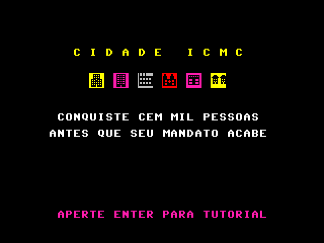
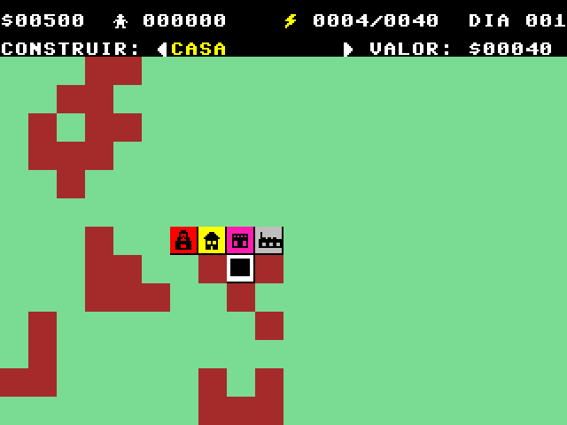

# Cidade ICMC

Jogo em Assembly para o Processador ICMC: SSC0513 Organização e Arquitetura de Computadores, ICMC-USP, 2026, Prof. Eduardo do Valle Simões.

Você é o prefeito: leve a cidade a **100 mil habitantes antes que seu mandato acabe** (dia 999). Um SimCity simplificado em que casa, comércio, indústria e energia precisam andar juntos.

 

**Vídeo:** _link do YouTube/Drive aqui_

**Grupo:** _nomes e números USP aqui_

## Como jogar

| Construção | Para que serve |
|---|---|
| Casa | onde as pessoas moram |
| Comércio | sem ele o povo vai embora |
| Indústria | dá emprego; sem emprego o povo sai (atrai um pouco de gente sozinha) |
| Usina | dá energia, mas tem limite; a primeira é de graça |

- A cidade só cresce se houver casa, emprego e comércio ao mesmo tempo, e energia para todos. Quem mora e trabalha paga a conta de luz: é daí que vem o dinheiro.
- Os prédios sobem de nível sozinhos quando estão cheios e sobra energia.
- Cada construção fica mais cara a cada unidade do mesmo tipo no mapa.
- Energia vermelha no topo = apagão: nada cresce até construir outra usina.
- Cada dia dura 10 s.

| Tecla | Ação |
|---|---|
| W A S D (ou setas) | andar |
| J / K | escolher o que construir |
| Espaço | construir (ou demolir) |
| + | acelerar o tempo (liga/desliga) |
| R | reiniciar |
| Enter | avançar nas telas |

Regras completas e balanceamento: [`DESIGN.md`](DESIGN.md).

## Rodar no Windows

Usa o pacote do professor, que já traz o simulador.

1. Baixe o [pacote do professor](https://github.com/simoesusp/Processador-ICMC/raw/master/Install_Packages/Simulador_Windows_Tudo_Pronto_F%C3%A1cil%20(1).zip) e extraia (por exemplo em Documentos). Vai aparecer a pasta `Simulador`.
2. Baixe este repositório (botão verde **Code > Download ZIP**) e extraia **dentro** da pasta `Simulador`. Fica assim:
   ```
   Simulador\
     Versao_05_2013\...
     usp-oac-trabalho-master\
       jogar.bat
       jogo.mif
       charmap.mif
   ```
3. Dê dois cliques em `jogar.bat`.
4. Na janela do simulador, aperte **Home** para ligar e depois **Enter**.

Observações sobre o simulador de Windows (versão 2013 do pacote):
- Não use o F7 do Sublime: o montador desse pacote é antigo e não conhece a instrução `SOUND`. Por isso o `jogo.mif` já vem montado.
- Ele não toca som e não aceita setas: use WASD.
- A velocidade depende do computador: o dia pode durar mais ou menos que 10 s.

## Rodar no Linux

Com o montador e o simulador gráfico do [Processador-ICMC](https://github.com/simoesusp/Processador-ICMC) instalados (`NovoMontadorLinux/` e `Simulator_Source/`, que precisa de GTK2 e SDL2):

```
montador jogo.asm
sim jogo.mif charmap.mif
```

Ou `./rodar.sh`, que monta e abre o simulador (procura `montador` e `sim` no PATH; sem montador, usa o `jogo.mif` pronto). Como compilar o GTK2 e o simulador no Arch, a cópia com a janela ampliada e o comportamento do simulador estão em [`FERRAMENTAS.md`](FERRAMENTAS.md).

## Processador em C (Simple Simulator)

`simple_simulator/simple_simulator.c` é o `simple_simulator_template.c` do professor completado: os ciclos de decodificação e execução de LOAD, STORE, LOADI, STOREI, MOV, ULA (ADD, SUB, MUL, DIV, MOD, AND, OR, XOR, NOT), INC/DEC, CMP, CALL, PUSH, POP e RTS, sempre pelos muxes e sinais de load do caminho de dados. Também foram feitos o teclado no Mux2, a ULA preservando as flags que a instrução não muda e o OUTCHAR desenhando na posição certa do terminal, com cor, para o jogo aparecer.

```
cd simple_simulator
gcc simple_simulator.c -O3 -march=native -o simple_simulator -Wall -lm
./simple_simulator ../jogo.mif          # o jogo no terminal (WASD, Enter)
./simple_simulator TesteCPU.mif         # teste do professor (monte antes o TesteCPU.asm)
```

O `TesteCPU.asm` do professor imprime uma letra por instrução testada: o resultado certo é `A B C D E F G H I J K L M N O P`, sem nenhum `X`.

No Windows, compile com o gcc do MinGW (o código tem `#ifdef _WIN32` com `conio.h`, como o professor indica) ou rode no WSL. A versão para Windows não foi testada.

## Arquivos

| Arquivo | O quê |
|---|---|
| `jogo.asm` | o jogo, comentado |
| `charmap.mif` | caracteres: letras do professor e os desenhos do jogo |
| `jogo.mif` | o jogo já montado |
| `jogar.bat` | abre o jogo no simulador do pacote de Windows do professor |
| `rodar.sh` | monta e abre o jogo no Linux |
| `simple_simulator/` | o processador em C e o teste do professor |
| `DESIGN.md` | regras, números, telas e sons |
| `FERRAMENTAS.md` | montador, simulador, comportamento e calibração |
| `arte/` | desenhos dos blocos e o gerador do `charmap.mif` |
| `balanceamento/sim.py` | simulação da economia |
| `ferramentas/` | emulador em Python e ferramentas de teste |
| `prints/` | telas do jogo |

## Requisitos do professor

1. Jogo em Assembly: `jogo.asm`.
2. Jogo rodando no simulador do processador: ver as seções de Windows e Linux.
3. Processador no Simple Simulator: `simple_simulator/simple_simulator.c`.
4. README, `jogo.asm` comentado, `charmap.mif` alterado, código C completo e link do vídeo (falta gravar).

Apresentação presencial nas últimas semanas do semestre, para todos do grupo; inscrição na planilha do professor com título, nomes e link do repositório.
